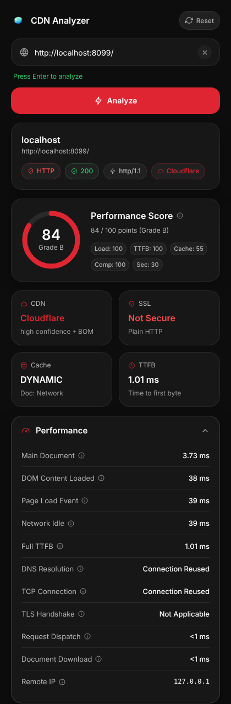

# CDN Analyzer

A Chrome extension that tells you which CDN is behind a website, and shows you why it thinks so.

Paste a URL, hit Analyze, and you get the provider (Cloudflare, Fastly, Akamai, CloudFront, Vercel and others), whether the page came from the edge cache, how long the server took to respond, and which security headers are missing. Every result comes with the evidence behind it, so you can check it yourself.



## How it works

The extension opens the page in a background tab, attaches Chrome's DevTools Protocol, and records the real network traffic. From that it looks at three things:

- **Response headers.** Many providers add their own headers, like `cf-ray` for Cloudflare or `x-amz-cf-id` for CloudFront.
- **DNS aliases.** If a hostname is a CNAME for something like `*.cloudfront.net`, that's a strong hint.
- **IP ranges.** If the server's IP is in a provider's published range, that shows who owns the network, but not which product is in use.

It does this for the page itself and for every image, script and font it loads, so you can see when a site uses one CDN for its HTML and another for its assets.

If nothing matches, it says **"No CDN signature found"**. That doesn't mean there's no CDN. Some hide their headers, and big companies like Google and Meta run their own networks.

## Install

1. Download the latest zip from [Releases](../../releases), or build it yourself (see below).
2. Unzip it.
3. Go to `chrome://extensions` and turn on **Developer mode**.
4. Click **Load unpacked** and pick the unzipped folder.

While an analysis runs, Chrome shows a "started debugging this browser" bar. That's expected: the extension needs the debugger permission to read network data.

## Project layout

```
extension/      the extension itself (load this folder in Chrome)
  modules/      detection, timing, cache, scoring and security logic
  icons/
tests/          test suites and header fixtures
scripts/        release packaging
docs/           screenshots
```

Provider fingerprints are in `extension/modules/providers.js`. To add a provider, add its headers or CNAME pattern there, with a fixture in `tests/fixtures/provider_fixtures.mjs`.

## Development

You only need Node.js 20 or newer. There are no dependencies to install.

```bash
node tests/run_all_tests.mjs       # run the tests
node scripts/package_release.mjs   # build dist/cdn-analyzer-pro-v<version>.zip
```

During development you can load the `extension/` folder directly in Chrome.

## Privacy

Everything runs in your browser and results aren't saved. The extension makes three kinds of outside requests:

- The site you're analysing, loaded in a background tab.
- DNS lookups for the site's hostnames, sent to Cloudflare DNS (with Google DNS as a fallback).
- The site's favicon, fetched from Google.

Cookies and authorization headers are removed from the results.

## Limitations

- A CDN that strips its headers and uses plain A records can't be detected.
- An IP inside a cloud provider's range shows who owns the network, not which product is in use.
- HTTP/3 doesn't mean a CDN is involved.
- When Chrome doesn't provide detailed timing, timings show as "Not Available" rather than an estimate.

## License

MIT
